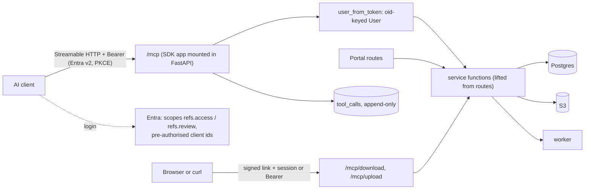

# Plan: MCP server for the Reference Engine (#249)

## Context

Bid teams want to use the reference engine from their own AI agents (Claude
Code, VS Code/Copilot, Cursor; later Claude Desktop). Through MCP tools they
should be able to:

- search and read references
- preview and download bid packs and case studies
- run research and use the library
- upload documents for indexing
- edit draft cases

The same identity, ACLs, anonymisation, review gates and audit apply as in the
portal. Anyone in Synechron can use it.

**How this plan was made.**
1. Two independent research passes (Fable, and Codex gpt-6-sol).
2. A draft plan.
3. An adversarial review of that draft by both, which found 6 blockers and 7
   major issues, all checked against the code.
4. This revision.

| Decided with the user (2026-10-13) | |
|---|---|
| Upload | Every signed-in user can upload. Uploads go into review and are visible to all staff only after approval. |
| Reviewer tools | Read and edit drafts over MCP, only from allow-listed AI clients. Approval stays in the portal. |
| Clients | Local clients first: Claude Code, VS Code, Cursor, over the corporate network. Claude Desktop/claude.ai later. |
| Create | A new reference is created from an uploaded document. There is no typed-text cases. |

**Repo facts the design rests on:**
- `infra/alb.tf:3`: the ALB is internal.
- `app/main.py:127-145`: the guard does CSRF/Origin and body caps before
  auth.
- `app/main.py:218`: `/auth` keys users on the ID token's `sub`.
- `app/research.py:187`, `app/library.py:112`, `app/render.py:743`,
  `app/main.py:57`: ownership, audit and revocation all key on that `sub`.
- `app/search.py:170`: source URLs never leave the server.
- `app/review.py:46`: `VERSION = md5(data)`.
- `app/main.py:264-268`: an upload queues one crawl for the whole source.
- `app/ingest.py:82-83`: dedupe is on `(source_id, external_id)`.
- `sql/roles.sql:13-21`: new tables get update and delete by default.

**Protocol baseline.** MCP **2026-07-28** (stateless, no sessions,
confirmations via multi-round-trip requests) plus **2025-06-18** for today's
clients. The Python SDK v2 serves both from one endpoint
(`stateless_http=True`).

## Architecture



### 1. Identity: one key for portal and MCP (phase 1 prerequisite)

Entra's `sub` is pairwise per application, so an MCP access token carries a
different `sub` from the portal's ID token. Identity therefore moves to
**`oid`**, which is the same across apps.

- **On login,** `/auth` stores `oid` as the session's `sub`, falling back to
  `sub` when `oid` is absent, for example with the mock IdP.
- **One-off backfill on first login after deploy:** a `user_keys(old_sub,
  oid)` row is written, and these columns are rewritten from the old sub to
  the oid in one transaction:
  - `research.created_by`
  - `library_items.created_by`
  - `briefs.created_by`
  - `generations.user_id`
  - `session_cutoffs.sub`
- **Testing:** the backfill is tested on a copy first and is idempotent.
  `revoke_sessions` accepts either form.

### 2. Auth on `/mcp`

- **Resource server.** The app is an OAuth 2.1 resource server using the
  SDK's `AuthSettings` and `TokenVerifier`.
  - `validate_token_resource=False`, because Entra's `aud` is the app id,
    which our verifier checks.
  - PRM is served at the root well-known path. Its exact path is verified
    after mounting, with `streamable_http_path="/"` at `/mcp`.
- **Verifier.** authlib, already a dependency, against Entra's JWKS. It
  requires:
  - `iss` = tenant v2
  - `aud` = our app
  - `exp`, `tid`
  - `scp` ∋ `refs.access` (delegated only; `roles`-only app tokens are
    rejected)
  - `iat` present: a missing `iat` fails closed
- **`user_from_token(claims)`** returns the same `User` as `/auth`: `oid`,
  name, `groups ∩ known_groups()`, `roles_for()`. It refuses group overage,
  and refuses when `iat` ≤ the user's `session_cutoffs` time. Group changes
  take effect within one token lifetime; this is documented.
- **Reviewer tools** require all of:
  - the reviewer role
  - `scp ∋ refs.review`
  - `azp ∈ MCP_REVIEW_CLIENT_IDS`, the signed client id, set in an env var
    like `ROLE_*_GROUPS`

  `clientInfo` is never trusted. Entra pre-authorises `refs.review` only for
  those clients. A missing scope gets 403 `insufficient_scope`, so clients can
  step up.
- **Guard (`app/main.py:127-145`).** For the exact paths `/mcp` and
  `/mcp/...`, the CSRF branch is skipped, because there is no cookie. The
  SDK's `transport_security` does the Host and Origin check
  (`allowed_origins=[APP_ORIGIN]`).
  - Unauthenticated requests reach the SDK unread, so clients still get the
    401 and `WWW-Authenticate` that starts login.
  - The body cap stays `BODY_CAP` (1 MiB) for `/mcp`, because uploads don't
    go through it.

### 3. Service layer, so the rules stay in one place

The bodies of `Form`-bound handlers are lifted into functions that both the
portal and MCP call:

- `render.produce(conn, user, fmt, …) -> (bytes, mime)`, with the
  `generations` row, from `app/render.py:724-747`
- `review.apply_edit(…) -> new_v` from `:243-318`
- `ingest.accept_upload(user, name, data) -> upload_id` from
  `app/main.py:235-273`
- `research.start()` from `:156-168`
- `library.save_item()` from `app/library.py:68-115`

Reused as they are: `search.results`, `browse`, `facets`, `render.build`,
`section`, `review.load`, `research.picked_claims`, `brief.start`.

### 4. Files out and in, without base64

- **Download.** `generate_output` validates through `render.build` and
  returns a link `https://<host>/mcp/download/<signed>`, plus the Markdown
  preview.
  - The link is itsdangerous-signed, holding `(oid, fmt, case_ids,
    research_id, library_ids, ack)` with a 10-minute max age. Nothing is
    stored.
  - The GET needs the portal session *or* a bearer token, either way with the
    same `oid`. It re-runs `render.produce()` and writes the `generations`
    row then, when bytes actually leave.
  - The response carries `Cache-Control: no-store`.
  - Tokens and links never go into logs or `tool_calls`.
- **Upload.** `upload_document(filename, size)` returns a signed 10-minute
  link, `/mcp/upload/<signed>`, holding `(oid, filename, size)`.
  - The user or agent sends it with `curl -T file -H "Authorization: Bearer
    …"`, or opens it in the browser.
  - The route runs `ingest.accept_upload()` under `upload_cap()`, with the
    same magic, extension and size checks as `/admin/upload`.

### 5. Uploads for everyone (phase 3)

- **Storage.** A new "Uploads" source (S3 prefix `uploads/`) whose ACL is
  `UPLOAD_ACL_GROUPS`, the all-staff group.
- **Tracking.** A new `uploads(id, oid, s3_key, created_at)` table, written by
  `accept_upload`. The crawl sets `documents.uploaded_by` by joining
  `external_id = s3_key`.
- **Status.** `get_upload_status(upload_id)` reads only rows where `oid` is
  the caller's, joining uploads, documents and cases. It returns safe status
  codes (`queued`, `indexed`, `in_review`, `approved`, `failed:<class>`),
  never job payloads or other files.
- **Quota.** An atomic quota of 20 uploads and 200 MiB per user per day,
  counted in `uploads`.
- **Visibility.** The tool description, the portal page and the review page
  say: "visible to all staff after a reviewer approves it", and "uploaded by
  X".
- **Duplicates.** Two users uploading the same file get two drafts. Reviewers
  merge them with the existing merge tool. This is stated plainly, and no SHA
  dedupe is claimed.
- **Portal.** "Upload a document" is opened to all users, so MCP and the
  portal stay equal.

### 6. Data rules

- **Destination.** The MCP client's LLM is a `third-party` destination.
- **General tools** return only the portal's cleaned views:
  - `results()` and `browse()` output (`app/search.py:57-61,212-220`), never
    `search()` objects
  - `render.section()` and `protect()`
  - a protected client name never appears, in any field or error
- **Source links** are the portal's `https://<host>/go/<doc_id>[/folder]`
  only. They are session-authenticated and ACL-checked, and the stored URLs
  are never returned.
- **Reviewer responses** use a field allowlist: case fields, prose, points
  with quotes, flags, `v`, and the document *label*. They never include
  `documents.text`, notes, raw source URLs or other cases.
- **Untrusted content.** Indexed and web text is wrapped as fenced data with
  an "untrusted content" preface, and technical notes are capped.
- **`tool_calls` audit.** One row per call, including refused calls and
  downloads: `oid`, `azp`, tool, object ids, outcome, ms. There are no
  arguments, bid text or results. Its role grant revokes update and delete,
  and it is shown in `/admin/audit`. Rate limits are counted from these rows.

## Tool catalogue

Every tool returns `structuredContent` with an `outputSchema` and a text copy.
Errors use the portal's messages. Rate limits are per `oid`.

| Tool | Access | Hints | Backed by |
|---|---|---|---|
| `search_references(bid_text≤4000, industry, region, tech, kind, sort, page)` | user | read-only, idempotent | `search.results`/`browse` |
| `get_case(case_id)` | user | read-only | `render.section` + `protect`; 404 when hidden |
| `list_latest(kind, page)` | user | read-only | `browse(sort="newest")` (approved and cleaned only) |
| `preview_output(case_ids≤3, research_id?, library_ids≤3, ack?)` | user | read-only | `render.build` → Markdown, with the `/go` links |
| `generate_output(…, format)` | user | read-only (the link writes the audit) | signed download link |
| `start_research`, `get_research` | user | open-world | `research.start`, view |
| `save_library_item`, `list_library`, `get_library_item` | user | — | `library.*` |
| `create_brief`, `get_brief` | user | — | `brief.start` |
| `upload_document(filename, size)`, `get_upload_status(upload_id)` | user (own uploads) | — | signed upload link, `uploads` table |
| `list_review_queue`, `get_review_case(cid)` → includes `v` | reviewer + `refs.review` + approved `azp` | read-only | `reviewable_cases`, `load`, allowlist |
| `edit_case(cid, v, field, …)` → new `v` and flags | same | write, `v` lock | `review.apply_edit` → the case returns to `extracted` |

**Not exposed:** approve, reject, merge, diagrams, admin, and deleting library
items. There are no typed-text cases.

## Phases

Each phase is its own PR and goes through the artifact gates: intent, spec
and plan files are written and approved in order for each phase. Your approval
here starts phase 1's intent. It doesn't replace that gate.

0. **Feasibility spike (time-boxed, on a dev tenant):**
   - Entra token acquisition with `refs.access` and `refs.review`
   - whether `oid`, `azp`, `scp` and `iat` are present
   - whether Entra accepts the RFC 8707 `resource` parameter
   - the mount path and PRM path
   - pinning `mcp` SDK v2 on Python 3.12
   - Claude Code and VS Code login with a pre-registered client id

   The results go into phase 1's spec.
1. **Identity and read-only:**
   - the oid migration and backfill
   - the verifier and `user_from_token`
   - the guard carve-out
   - `tool_calls`
   - tools: `search_references`, `get_case`, `list_latest`, `preview_output`
   - a mock IdP issuing access tokens (`JSON_CONFIG` claim mappings for
     `scp`, `groups`, `oid` and `azp`)
   - `docs/mcp.md` for Claude Code and VS Code
2. **Outputs and research:** `generate_output` with signed download links;
   the research, library and brief tools; Cursor in the docs.
3. **Uploads for everyone:** the Uploads source, the `uploads` table, signed
   upload links, status and quota, and the portal upload for all users.
4. **Reviewer tools:** the `refs.review` scope and `azp` allow-list,
   `list_review_queue`, `get_review_case` and `edit_case`.
5. **Later, after a security sign-off:** a public WAF-fronted ingress for
   `/mcp` only, allow-listed to Anthropic's ranges, for Claude
   Desktop/claude.ai.

## Installation (`docs/mcp.md`, grown per phase)

**Entra, done once by an admin.**
- App registration "Reference Engine MCP".
- `api://<id>`, scopes `refs.access` and `refs.review`.
- v2 tokens, groups claim (overage refused).
- Pre-authorised clients with their redirect URIs: our public client for
  Claude Code, the VS Code client, Cursor. `refs.review` is pre-authorised
  for the review-approved clients only.

**User.**
- **Claude Code:**

  ```sh
  claude mcp add --transport http --client-id <id> refs https://<host>/mcp
  ```

  Then run `/mcp`, which opens Entra SSO in the browser.
- **VS Code:** **MCP: Add Server**, choose HTTP, enter the URL, and set
  `oauth.clientId`.
- **Cursor:** set `auth.CLIENT_ID`.
- **Downloads and uploads:** open the returned link in the browser, or run
  `curl` with the bearer token.
- **Troubleshooting:** VPN, groups, the 401 and 403 reasons.

**Local dev.** `docker compose up`, then the mock IdP, then MCP Inspector
with a bearer token.

## Critical files

- **New:**
  - `app/mcp_server.py` (tools, verifier, `user_from_token`)
  - `docs/mcp.md`
  - `tests/test_mcp_auth.py`, `tests/test_mcp_tools.py`,
    `tests/test_mcp_http.py`
- **Changed:**
  - `app/main.py`: guard, lifespan, `/auth` oid and backfill, download and
    upload routes
  - lifts in `app/render.py`, `app/review.py`, `app/research.py`,
    `app/library.py` and `app/ingest.py`
  - `sql/schema.sql`: `user_keys`, `tool_calls`, `uploads`,
    `documents.uploaded_by`, the Uploads source
  - `sql/roles.sql`: `tool_calls` append-only
  - `app/audit.py`
  - `app/revoke_sessions.py`
  - `docker-compose.yml`: mock IdP claim mappings
  - `pyproject.toml` and `requirements.lock`: `mcp` pinned

## Verification

- **HTTP-level tests** (ASGI, not just the in-memory client), against the
  real mount:
  - both protocol eras
  - 401 with `WWW-Authenticate` and PRM
  - wrong `aud`, `iss` or tenant; expired; missing `iat`; app-only;
    `insufficient_scope`; group overage; cut-off user; an ID token used as an
    access token
  - a foreign Origin gives 403
  - unauthenticated large bodies are not read
- **Contract tests:** the SDK client against every tool; `structuredContent`
  must match `outputSchema`.
- **Parity tests:** for the same user and inputs, MCP equals the portal's
  `/search` and `/preview`, and the `/mcp/download` bytes equal `/generate`'s.
  `edit_case` from a user gets the same 403 as `require("reviewer")`. Hidden
  cases give 404.
- **Leak tests:** no protected client name, `documents.text`, stored source
  URL, other user's upload, signed token or bid text appears in any tool
  output, error, log line or `tool_calls` row.
- **Identity tests:** the oid backfill moves research, library, briefs,
  generations and cutoffs, and is idempotent. A portal session and an MCP
  token for one person see the same items.
- **Upload tests:** the quota, owner-only status, an expired or forged link,
  the cap, and the review-only visibility.
- **Manual:** MCP Inspector locally. Claude Code end to end against the demo:
  search, preview, generate and open Word. A read-only Codex review per phase.
- **Full suite:** `docker compose build app && docker compose run --rm app
  pytest`.
