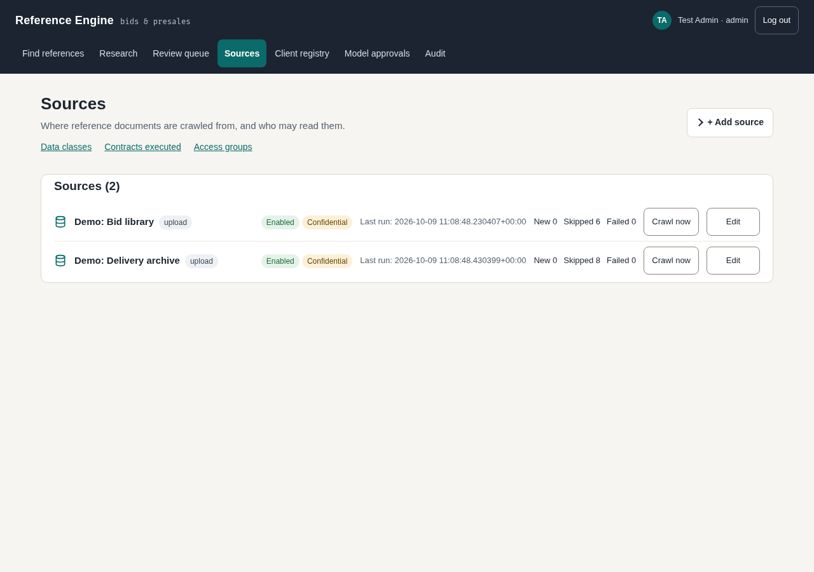
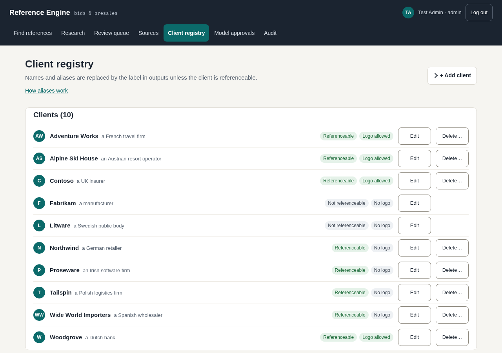
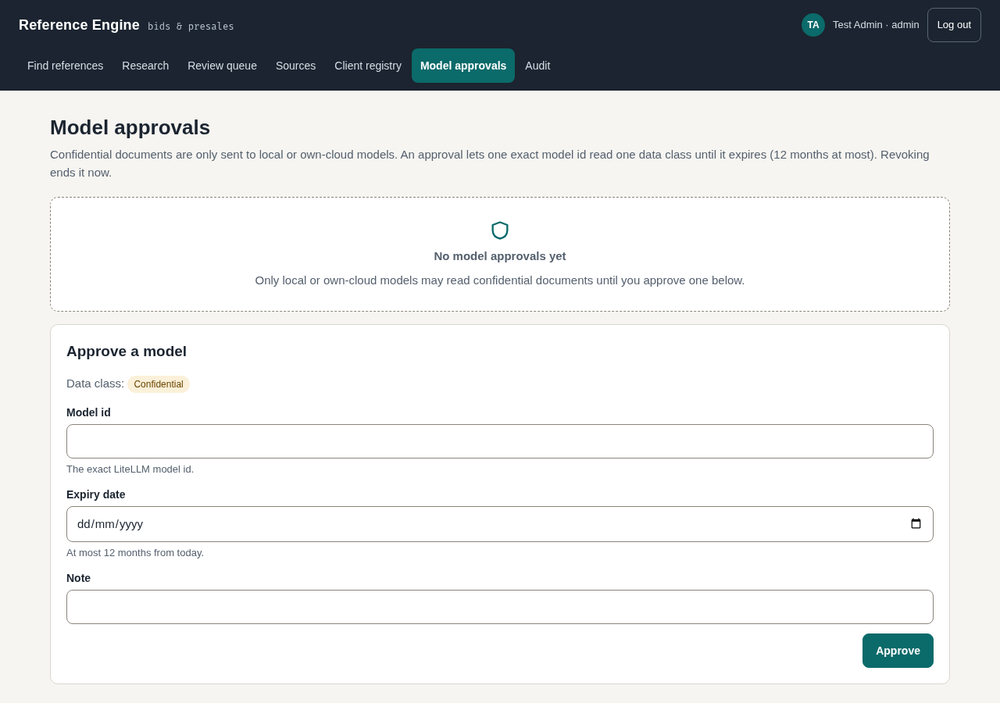
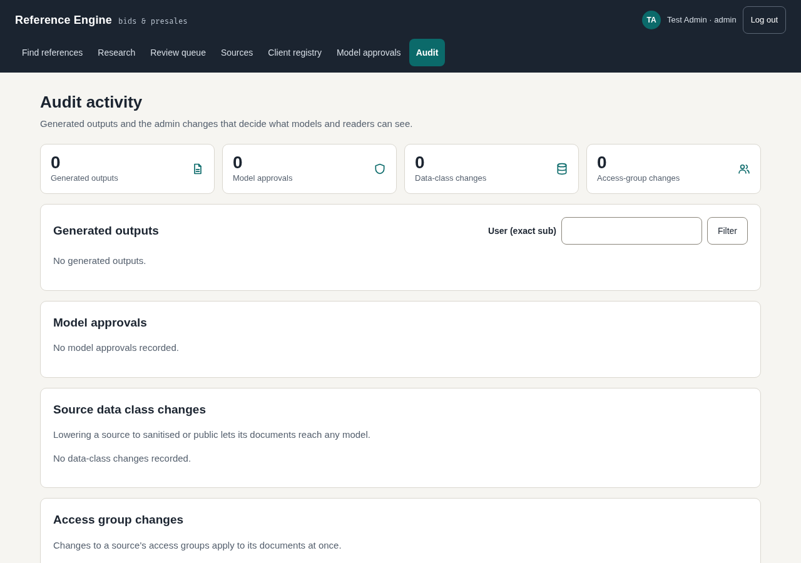

# Admins

For people who run the portal's content: sources, client names, approved models and the audit trail.
Admins can also do everything [reviewers](reviewers.md) and the [bid team](bid-team.md) can.

## Manage sources



**What it's for**

Choosing where reference documents are crawled from, and who may read them.

**Steps**

1. Open **Sources**.
2. To add one, open **+ Add source**, choose the **Kind**, and fill in **Name**, the kind's own fields, **Data class** and **Access groups**. Then press **Add source**. The kind's own fields are:
   - S3: **Bucket**, plus an optional **Prefix** and **File types**
   - upload: **Bucket**, **Prefix** and optional **File types**
   - SharePoint: **Tenant ID**, **Drive ID** and optional **File types**
   - Confluence: **Site URL**, **Spaces** and **API prefix**
3. To change one, press **Edit** on its row, then **Save**.
   - The bucket, tenant and drive, site URL, and an upload source's prefix can't be changed. To change one, add a new source and disable the old one.
   - The name, prefix, file types, spaces and API prefix can be changed. Any change to these makes the next crawl a full one. Narrowing them withdraws the documents outside the new scope.
   - While a source is being crawled, its edits are refused until the crawl finishes.
   - Every change is recorded on **Audit**.
4. Open the help panels on the page when unsure:
   - **Access groups**: the groups whose members can read the source. SharePoint files whose permissions differ from the site root, and Confluence pages with a read restriction, are skipped by the crawl. Enter only groups that can read all of the site or space.
   - **Data classes**: confidential documents only go to local or own-cloud models unless a model is approved. Mark a source sanitised or public only when that is true.
   - **Contracts executed**: tick it only when every statement of work or change order in the source is signed.

**What you see**

A row per source with its number (the source id crawl jobs use), its kind, whether it is enabled, its data class and when it last ran.

## Check connections and sign-in

**Steps**

1. Open **Settings**.

**What you see**

- **Connections**: the SharePoint, Confluence, S3, Brave and model settings, and whether each secret is configured. Secret values are never shown.
- **Sources**: each source's last run, its counts, and when a crawl last failed.
- **Single sign-on**, **Roles** and **MCP**: the sign-in provider, which groups grant each role (yours are marked), and the MCP settings.

These are set in Terraform and Secrets Manager, not in the portal. A wrong sign-in value could lock every admin out.

## Crawl a source

**What it's for**

Pulling in new documents without waiting for the schedule.

**Steps**

1. Press **Crawl now** on the source's row.
2. Press **Edit** to see **Last run counts** after it finishes.

**What you see**

The row shows New, Skipped and Failed counts for the last run. "Skipped" includes files left out
because of their permissions or restrictions.
Files skipped for their type or size are also withdrawn if an earlier version is in search, so narrowing an S3 or SharePoint source's types (`include_ext`) withdraws matching documents on the next crawl.

## Upload a document

**What it's for**

Adding a single file to an upload source.

**Steps**

1. Add a source with **Kind** `upload`, a **Bucket** such as `example-bid-library` and a **Prefix** such as `cases/`.
2. On that source's row, press **Upload**, choose the file, and press **Upload** again.

Scripts can send the file instead. The curl option `-b cookies.txt` reads your signed-in session cookie
(copy it from your browser into that file); `source_id` is optional, and without it the file goes to the
first enabled upload source. Replace `localhost:8000` with your portal address:

```
curl -b cookies.txt -H 'Origin: http://localhost:8000' \
  -F file=@sample-case.docx -F source_id=1 http://localhost:8000/admin/upload
```

**What you see**

Back on the Sources page, a line saying the file was queued for crawl, with the job number and source.
The document is crawled shortly after. Only `.docx`, `.pptx` and `.pdf` files are accepted; a refused
file shows the reason instead. A script gets a reply with the job number.

## Client registry



**What it's for**

Deciding which client names are hidden in outputs and which may be shown.

**Steps**

1. Open **Client registry**.
2. To add a client, open **+ Add client**, fill in **Name**, **Aliases (one per line)** and **Label in outputs**, tick **Referenceable** or **Logo allowed** if they apply, and press **Add client**.
3. To change one, press **Edit**, then **Save**.
4. Open **How aliases work** for advice on aliases.

**What you see**

Each client with its label and badges. Names and aliases are replaced by the label in outputs unless
the client is referenceable.

## Model approvals



**What it's for**

Allowing a specific AI model to read confidential documents, and choosing the extraction and drafting models (`EXTRACT_MODEL` and `DRAFT_MODEL`, set via `extract_model` and `draft_model` in Terraform).

**Supported model families**

| Family | Example model id | Where it runs | Confidential data |
| --- | --- | --- | --- |
| Claude on AWS Bedrock | `bedrock/eu.anthropic.claude-sonnet-4-5-20250929-v1:0` | `our-cloud` | Allowed without a Models-page approval |
| OpenAI | `openai/gpt-5`, `openai/gpt-5-codex` | `third-party` | Needs an active Models-page approval |
| Google Gemini | `gemini/gemini-2.5-pro` | `third-party` | Needs an active Models-page approval |
| Ollama | `ollama_chat/qwen3:14b` | `local` (or `third-party` for cloud hosts) | Local hosts allowed; cloud hosts need an approval |

- **Claude runs through Bedrock only.** Anthropic's direct API is not used. When `extract_model` or `draft_model` uses a Bedrock cross-region inference profile (such as `bedrock/eu.anthropic.claude-sonnet-4-5-20250929-v1:0`), put both the inference profile ARN and the foundation-model ARNs in `bedrock_model_arns`.
- **Prefer a general GPT model over Codex for extraction.** For `EXTRACT_MODEL` (`extract_model`), use a general model such as `openai/gpt-5` rather than `openai/gpt-5-codex`.
- **OpenAI and Gemini are always third-party.** They cannot be relabelled as `local` or `our-cloud` in `EXTRACT_MODEL_OPTIONS` or `DRAFT_MODEL_OPTIONS`. They may read confidential documents only when the exact model id has an active, unrevoked approval on **Model approvals**.
- **Provider key secrets.** OpenAI models read `OPENAI_API_KEY` and Gemini models read `GEMINI_API_KEY`; each key is sent only to its own provider. In AWS, Terraform creates the Secrets Manager secret `<name>/openai-api-key` or `<name>/gemini-api-key` only when `extract_model` or `draft_model` starts with `openai/` or `gemini/`, and passes it to the `web` and `worker` tasks. Fill any created secret before starting the tasks. **Settings** shows only whether `OPENAI_API_KEY` and `GEMINI_API_KEY` are configured, never their values.

**Steps**

1. Open **Model approvals**.
2. Under **Approve a model**, fill in **Model id** (for example `openai/gpt-5` or `gemini/gemini-2.5-pro`), **Expiry date** (at most 12 months away) and a **Note**.
3. Press **Approve**.
4. To end an approval early, press **Revoke** on its row. Revoking an approval stops confidential calls to that model at once.

**What you see**

A table of approvals, "Active" or "Expired", with who approved each and when it expires.

## Audit



**What it's for**

Seeing who generated what, and which admin changes were made.

**Steps**

1. Open **Audit**.
2. Read **Generated outputs**. To look at one person, type their id in **User (exact sub)** and press **Filter**.
3. Use **« newer** and **older »** to page through.
4. Further down are **Model approvals**, **Source data class changes** and **Access group changes**.

**What you see**

A row per download with its time, format, user, cases, whether it was anonymised and the
**Industry-only ack** column, which says whether the user acknowledged an industry-context download.
