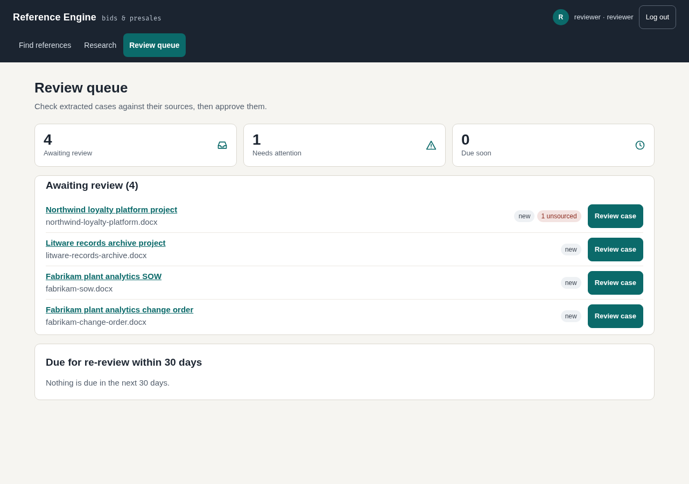
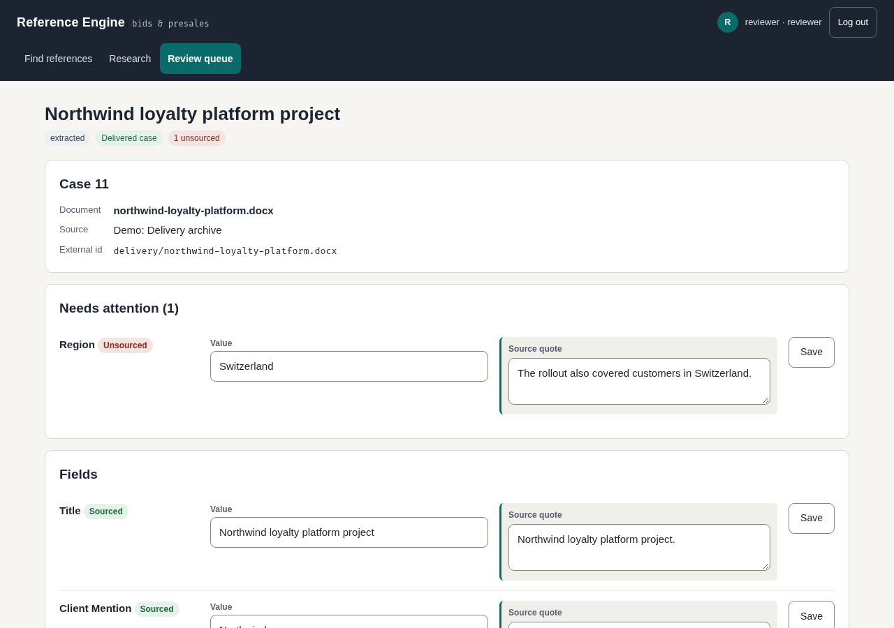

# Reviewers

For people who check extracted cases against their sources before they can be used in bids.
Reviewers can also do everything the [bid team](bid-team.md) can.

## Work through the queue

**What it's for**

Seeing which cases need a decision.

**Steps**

1. Open **Review queue**.
2. Look at **Awaiting review**, **Needs attention** and **Due soon** at the top.
3. In the list, each case shows "new" or "re-review due", and how many notes or unsourced fields it has.
4. Press **Review case** on the one you want.

**What you see**

A list of cases with a title and the document or number of contracts behind each. When there is
nothing to do, the page says "Nothing to review".

## Sourced and unsourced fields

**What it's for**

Knowing which facts are backed by the source document.

**Steps**

1. On a case page, read the **Needs attention** box above **Fields**: it lists the fields that need a look first. Then read the **Fields** section.
2. Check the badge on each field: "sourced", "unsourced", "empty", "written by reviewer", or "no quote (generated)".
3. Compare the value with its **Source quote**.
4. For implementation, configuration or lessons learned that the document doesn't describe, write the text, tick **I wrote this: no document quote** and Save. Approving keeps it; outputs show it without a mark.

**What you see**

A field is "sourced" when its quote is found in the document. An "unsourced" field has a value the
document does not back up.

## Edit a field

**What it's for**

Fixing a value or its quote.

**Steps**

1. Change the value, or the text in **Source quote**.
2. Press **Save** on that row.

**What you see**

The page reloads with the new value, and the badge shows whether it is now sourced.

## Add or remove list items

**What it's for**

Fixing lists such as capabilities, technologies and outcomes.

**Steps**

1. To add an item, fill in the empty row at the end of the list, with its quote, and press **Add**.
2. To drop an item, press **Remove** on its row.

**What you see**

The list shows the change after the page reloads. A blank item is refused.

## Add diagrams

**What it's for**

Adding a picture, such as an architecture diagram, to a case. A case can have up to 5. Nothing is
taken from the documents: you upload each one yourself.

**Steps**

1. On a case page, find the **Diagrams** section. Choose a PNG or JPEG file of up to 5 MB, type a caption, and press **Add diagram**.
2. The diagram shows "Processing: reload in a moment". Reload the page until it shows the picture. If it shows "Rejected", the reason is given and the picture is not used.
3. To change a caption, edit it and press **Save caption**. To drop a diagram, press **Remove**.
4. Look at every picture. Before **Approve (unsourced fields are emptied)** you must tick **I have checked every diagram: no client name, logo, person or identifying detail**.

**What you see**

Ready diagrams are added to the Word, PowerPoint and PDF outputs, and their captions are listed in the Markdown.
Approval waits while a diagram is still processing. Adding, changing or removing a diagram takes an approved case back to review, so you must approve it again.

## Decide: approve or reject

**What it's for**

Letting a case into search, or turning it down.

**Steps**

1. Under **Decision**, read the warning: "Approving empties every unsourced field. Check the quotes first."
2. Press **Approve (unsourced fields are emptied)** when the case is good, or **Reject** when it is not.

**What you see**

An approved case can appear in search. Unsourced fields are emptied on approval, so fix or source
them first. A rejected case does not appear in search.

## Add a client name

**What it's for**

Protecting a client name that the registry does not know yet. Admins only: you see this
button only if you are also an admin.

**Steps**

1. When a case page says "organisation not in client registry", type a label such as "a retail bank".
2. Press **Add as client**.

**What you see**

The name is added to the registry and hidden in outputs. Use it for clients only. A partner or
vendor added here is hidden in every output.

## Merge contracts

**What it's for**

Joining several contracts for the same client into one case.

**Steps**

1. On a case page, under "Merge with other contracts for the same client", tick the contracts to join.
2. Press **Preview merge**.
3. On **Merge contracts**, look at **Differing fields** and choose which contract each value comes from.
4. Press **Merge**.
5. To undo, open the merged case and press **Un-merge (the contracts go back to the queue)**.
6. If a contract changes or is withdrawn after the merge, the merged case shows it. Press **Re-merge with the current contracts** to rebuild the
   case from the current versions. Your field choices are kept, your edits are not, and the case needs a new summary and approval.

**What you see**

One new case that needs a new summary and a fresh approval. Capabilities and technologies are
combined and outcomes are dropped.

## Attach public sources

**What it's for**

Keeping the public best-practice statements you accept with the case, so every download of it can cite them.

**Steps**

1. On the search result, press **Research this (public sources)**.
2. On the research result, tick the claims you accept.
3. Press **Attach to the case as public sources**. A case holds at most 20.
4. To take one off, open the case on the review page and press Remove on it under "Public sources (not delivery evidence)".

**What you see**

Every download of the case shows the attached sources under "Best practice and public sources", marked as
statements by third parties, not our delivery. Attaching or removing does not change the case's approval.

## Re-review

**What it's for**

Keeping approvals current. An approval expires after 12 months and the case leaves search until it is
approved again.

**Steps**

1. Check **Due for re-review within 30 days** on the queue page.
2. Open each case. Approve it as it is to renew it for 12 months; it stays in search. If you edit it,
   it leaves search until you approve it again.

**What you see**

Each due case shows when it expires. Cases already expired appear in the main list as "re-review due".
