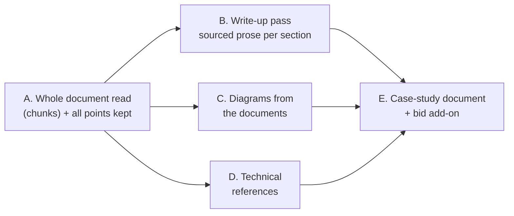

# Spec: Case studies rich enough to present to a customer

## Why the trial cases came out thin

The prompt is not the only cause. Reading the code turned up three:

1. **The local model only sees part of the document.** `extract.build()` sends
   up to `MAX_CHARS` = 150,000 characters in one call. Locally,
   `EXTRACT_MODEL_OPTIONS` sets `num_ctx` to 24,576 tokens, and `MAX_TOKENS`
   reserves 8,192 of them for the reply. That leaves roughly 15k tokens, or
   about 50k characters, for the document. The trial documents are 37k-193k
   characters long. Ollama does not raise an error when the input is too long;
   it drops input tokens silently. Most of each document never reached the
   model.
2. **Every point after the first is thrown away.** `schema.assemble()` keeps
   only the first item it sees for each text field ("first value wins"). If
   the model returns five challenge items, four are discarded.
3. **The prompt asks for little.** It asks for "a short value" and "1 to 3
   sentences each", and the summary is capped at 80 words.

Fix 1 and 2 first. Better text on top of a truncated document can't work.

## Design

The work ships in five phases, each its own PR, each usable on its own.

### A. Read the whole document, and keep every point (`app/extract.py`, `app/schema.py`)

- **Chunked extraction.** `build()` splits the text into chunks that fit the
  model's context, then runs the existing extraction prompt on each chunk.
  - Chunk size comes from the model profile:
    `(num_ctx - MAX_TOKENS - 2,000) × 3` characters, using a conservative 3
    characters per token. That gives about 43k characters at 24,576 tokens.
    Without `num_ctx` (Bedrock), one chunk holds up to `MAX_CHARS`, exactly as
    today.
  - Chunks split on paragraph boundaries and overlap by 1,500 characters.
  - `MAX_CHARS` rises to 400,000. Each extra chunk costs one more model call,
    so the budget is still finite; truncation is still reported in
    `needs_attention`.
  - Every chunk's items go into one `Extraction`, and `assemble()` runs once.
    `check()` verifies every quote against the full text, not just its
    chunk, so a quote from any chunk is still checked.
  - Summary: each chunk returns one. The write-up pass (B) replaces it. Until
    B ships, the summary is the first chunk's summary that passes
    `summary_sourced()`.
- **Points.** `challenge`, `solution`, `implementation` and `configuration`
  keep their existing single `Sourced[str]` value. That is the headline, so
  search, merge, render and review are unchanged. Every item for those fields
  also goes into a new `points: dict[str, list[Sourced[str]]]` on
  `ReferenceCase`, holding the first item and all the later ones.
  - Points are deduplicated on normalised value.
  - At most 12 points per section, so a runaway reply stays bounded.
  - `check()` marks each point exactly like its field.
  - `strip_commercial()` and `basis == "engagement"` apply to points: prices
    are stripped, and engagements get no lessons.
- **Prompt.** The prompt asks for "one item per distinct point" for these four
  fields: the client's situation and drivers, scope and deliverables,
  phases/method/team, and each configuration or integration. That replaces
  "1 to 3 sentences each". Quote rules are unchanged.
- **Overflow guard.** `llm.complete_json()` estimates prompt tokens with the
  same 3-characters-per-token rule. If the estimate exceeds `num_ctx`, it
  raises instead of letting Ollama drop input silently. Chunking makes this
  unreachable for extraction, but it protects triage and research too.

### B. Write-up pass: sourced prose per section (`app/writeup.py`, new)

- **When it runs.** After `build()`, a second call to `EXTRACT_MODEL` per case
  with `WRITEUP_SYSTEM`. The input is the sourced points only: for each
  section, a numbered list of value and quote. It never sees the document. So
  it can only rephrase what was extracted, and its input is small: a few
  thousand tokens, whatever the document's length.
- **What it returns.** `Writeup`, which is `{section: text}` for
  `challenge, solution, implementation, configuration`, plus `summary`. Each
  section is 1 to 4 paragraphs, written in third person and past tense for
  delivered work, or the planned approach for an engagement. Paragraph count
  is limited by the points available: a section with one point gets one or
  two sentences.
- **Checks** (`check_prose()`), which run on the model output and on every
  reviewer edit:
  - Every number in a section must appear in that section's quotes. This is
    the `numbers()` rule `summary_sourced()` already uses.
  - Every capitalised term not at the start of a sentence (product, company or
    standard names, for example "Kafka" or "ISO 20022") must appear in that
    section's quotes, compared after normalisation.
  - `strip_commercial` patterns must not match.
  - A section that fails is still stored, but flagged: the failing terms are
    listed in `needs_attention` ("Solution write-up names 'Snowflake', which
    no quote supports"), and the review page highlights it. Approval is
    blocked until the reviewer fixes the text or overrides it
    (`by_reviewer`).
- **Stored as** `ReferenceCase.prose: dict[str, Prose]`, where
  `Prose = {text, by_reviewer, flags}` and is hidden from the extraction LLM
  schema. A re-extraction keeps a reviewer's prose, under the same rule as
  #198 `by_reviewer`.
- **Review page** (`review.py`, `review_detail.html`). Each of the four
  sections shows the prose in an editable text area, with its sourced points
  and quotes listed underneath (collapsed). The flags appear next to it. The
  existing edit route saves prose and runs `check_prose()` again.

### C. Diagrams from the documents (`app/diagrams.py`, `app/ingest.py`)

- **At ingest** (worker), for docx and pptx, the worker reads the zip's
  `word/media/` and `ppt/media/` entries.
  - It keeps PNG and JPEG images of at least 30 KB and at least 400 px on the
    short side. That drops logos and icons.
  - It keeps at most 10 per document, largest first.
  - The caption hint is the image's alt text (`descr` in the drawing XML) or
    the slide title, cut to `MAX_CAPTION`. The hint is anonymised before the
    reviewer sees it, and it stays editable.
- **Stored** in the existing `diagrams` table with `status = 'candidate'` and
  the source `document_id`, using the same `_decode()` re-encode as #200
  (strips EXIF, text chunks and ICC).
- **Review.** Candidates appear on the review page as thumbnails with
  "Use" and "Dismiss". "Use" turns a candidate into a normal case diagram
  (`ready`, counted against `MAX_PER_CASE`, which rises to 8), so it renders
  exactly like #200 uploads. Only a diagram the reviewer has used can reach
  an output.
- **Not in this issue:** EMF, WMF and SVG (vector) images, and pictures
  inside PDFs. The trial docs have them, but each needs a converter. They are
  a follow-up issue.

### D. Technical references (`app/schema.py`, `app/extract.py`, `app/render.py`)

- A new extraction field, `reference`, is added to the prompt. It captures a
  standard, a protocol, an interface or integration point, or a
  product-and-version that the document names, as written. Examples are
  "ISO 20022 pacs.008", "SWIFT gpi", "Kafka 3.4" and "REST API to the core
  banking system".
- It is stored as `tech_references: list[Sourced[str]]` and is
  literal-checked like `tech_stack`.
- **Output section "Technical references":** `tech_stack` plus
  `tech_references` plus the public sources the reviewer attached (#199,
  rendered with #23's "<host> states:" line).

### E. Case-study document and bid add-on (`app/render.py`, `brand/`)

- **Standalone case study.** New formats `case_study_docx` and
  `case_study_pdf`, one case per document, built from a new template
  `brand/case_study.docx`. The template is generated by
  `scripts/make_reference_template.py`, as `reference.docx` is, until
  marketing's template (#15) arrives. Layout:
  1. Cover: title, industry, region, period, and the client name or its
     anonymised form.
  2. At a glance: summary and the key outcomes table.
  3. Challenge, Solution, Implementation approach, Configuration and
     integration: approved prose, with the headline value as fallback.
  4. Architecture: the used diagrams with captions.
  5. Technical references (D).
  6. Lessons learned, for delivered work only.
  7. Footer: "Based on <n> source document(s) reviewed by <role> on <date>".
     Names are never shown.
- **Bid add-on.** The existing formats (docx, pptx, pdf, md, and the preview)
  use the approved prose in place of the one-line values when it exists, and
  add the Technical references section. A case without prose renders exactly
  as today.
- **Same rules as today.** The preview (#197) shows exactly what each format
  will contain, `section()` then `protect()` anonymise all new text, and
  `blocked()` drops an output that still names a protected client.

### Model and local quality

The target is `qwen3:14b` at `num_ctx` 24,576, which is the README setup and
fits a 20 GB GPU. Chunking (A) and the small write-up input (B) are what make
it work. `qwen3.8:27b` is an optional `EXTRACT_MODEL`, used for comparison in
verification. It is not required, because its weights leave little GPU memory
for context.

## Alternatives rejected

- **Raise `num_ctx` to 64k or more.** The KV cache doesn't fit a 20 GB GPU
  with a 14B model, and Ollama falls back to CPU, which is many times slower.
  It's also not portable.
- **One bigger prompt asking for long sections.** Long free text with a single
  quote can't be checked: a paragraph can drift far from its quote. The
  points-then-prose split keeps each claim checkable.
- **Write-up from the whole document.** The input would be too large for the
  local model, and the prose could cite anything in the document without a
  quote. Feeding only quoted points is what makes the write-up checkable.
- **Converting EMF, WMF and SVG now.** That means LibreOffice per image or a
  new dependency (cairosvg) in the worker, which is extra attack surface for
  untrusted files. PNG and JPEG cover most of the trial's diagrams. Vector
  formats are a follow-up.
- **A separate "case study" database object.** It's the same facts and the
  same review, so it lives on the case. Only rendering differs.

## Risks

- **Time.** Extraction makes more model calls: about 5 for a 193k-character
  document, plus 1 write-up call. Locally that is roughly 1-2 minutes per
  call. That's acceptable for a background worker, but the stale-job timeout
  (#132) must allow it, and the plan checks it.
- **Duplicate points across chunk overlaps.** Points are deduplicated on
  normalised value. Near-duplicates can remain, and the write-up merges them
  in the prose.
- **The prose check is a heuristic.** Capitalised-term matching misses a
  lowercase invented fact, such as "real-time", and can flag a harmless word,
  such as a capitalised heading word. It narrows what slips through; it
  doesn't replace the reviewer, which is why the quotes are shown next to the
  prose.
- **Images can contain client names or logos.** Only a reviewer's "Use"
  releases an image. Candidates never reach an output. This is stated on the
  review page.
- **Schema growth.** New fields default to empty, so old cases load and
  render as today. No migration is needed: `cases.data` is JSON.
- **Search text.** Points and prose are added to `search_text()`, so
  longer cases match more queries. The recall gate (#24) measures the effect
  once the 50 queries exist.

## Verification

- **Unit tests,** per phase:
  - Chunking: boundaries, overlap, and a quote found only in the last chunk
    being accepted.
  - The overflow guard raising.
  - `assemble()` keeping every point, deduplicated and capped.
  - `check_prose()`: a number that is in no quote and a name that is in no
    quote are both flagged, and a clean text passes.
  - Image candidates: the size filter, and alt text read and anonymised.
  - Each new format renders, and anonymisation applies to prose, captions and
    references.
  - A case without the new fields renders exactly as before.
- **Trial before and after** (`scripts/eval_extraction.py`, which prints
  metrics only, never text):
  - Run it on the 11 trial documents with `ollama_chat/qwen3:14b`, before and
    after phase A, and again after B.
  - Report, per document: chunks, points per section, words of prose per
    section, unsourced and flagged counts, and candidate diagrams.
  - For cases 16 and 17, expect at least 3 points and 120 words of prose in
    each of Challenge and Solution, wherever the document supports it.
- **By hand in the demo stack:** re-crawl the trial source, open cases 16 and
  17 in review, use a document diagram, approve, and download
  `case_study_docx` and the bid docx. Check that the preview matches both.
- **Full suite** after each phase:
  `docker compose build app && docker compose run --rm app pytest`.
