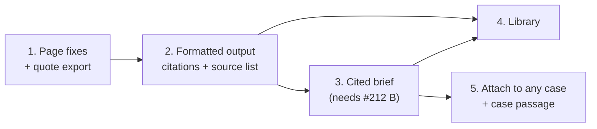

# Spec: Research we can reuse as our own content

## Decisions for approval

The intent left three questions open. The spec proposes these answers:

1. **Library visibility: every portal user** (role `user`). The content is
   public statements. The topic name is scrubbed exactly like a research
   query (`research.finalize()`), so it can't name a protected client.
2. **Freshness: saved items show their age,** and are flagged "re-check"
   once they are 12 months old. They are never deleted automatically.
3. **Order: five phases, one PR each.** Phases 1, 2 and 4 don't depend on
   #212. Phases 3 and 5 need #212 phase B (the write-up pass and
   `check_prose()`).

## Design

### Phase 1: Page fixes and quote export (`research_view.html`, `app/research.py`)

- **Actions on top.** The download card (`research_view.html:28-34`) moves
  above "What public sources say" and the Comparison table. It becomes an
  action bar: Preview, Download, Export and, from phase 3, Brief.
- **No AI type label.** The `({{ c.type }})` label is removed from the
  Comparison rows (`:26`) and from each claim. This matches #23: the type
  only filters. The AI one-liner (`c.statement`, `:20`) stays, under the
  quote, prefixed "AI reading:" as the page note already says.
- **Select quotes.** Every user gets a checkbox per claim. Today only a
  reviewer on a case-bound result gets one (`can_attach`). The selection
  feeds Export now, and Brief, Save and Attach later.
- **Export.**
  - New route `POST /research/{rid}/export` with `n[]` and
    `format = md | csv`. It loads the row under `created_by`, as
    `research_view` does (`:182`).
  - The picked claims come from the stored row, never from the form, as in
    `attach_sources` (`review.py:408`).
  - They go through `visible_claims()` (`research.py:168`), so `apply()`
    and `blocked()` run as on the page.
  - Markdown is a numbered quote list followed by the source list
    (phase 2's layout). CSV has the columns quote, publisher, page title,
    url and retrieved.
  - **CSV injection:** a cell starting with `= + - @`, tab or CR gets a
    leading `'`.
  - "Copy" shows the Markdown in a read-only textarea to select and copy.
    That needs no JavaScript, since `app/static` has only CSS and fonts.

### Phase 2: Formatted output with no model call (`app/render.py`)

The industry-context section stops being one bullet per claim with an inline
URL. This changes `industry_section()` (`render.py:50`), the Markdown
template (`:369`), `slide_statements()` (`:76`) and the preview.

- **Grouped by source page,** in rank order (`source_rank`):
  - Each group has a heading: the page title, or the host if there is no
    title.
  - Its quotes appear under it, each followed by a numbered citation `[n]`.
  - The fixed lead "`<host>` states:" (#23) stays on the group heading.
- **Source list at the end:** `[n] page title, host, URL, retrieved date`.
  URLs leave the body.
- **Page title:** `extract_claims()` (`research.py:476`) adds
  `"title": p["title"]` to each claim. Rows stored before that fall back to
  `results.pages[*].title` looked up by URL, and then to the host.
  `SOURCE_KEYS` (`review.py:375`) gains `title`, so attached sources keep
  it.
- **Formats:**
  - Word renders one item per group, plus a source list block through the
    template's existing loop over `industry.statements`.
  - pptx renders one group per line, the same as today, at most
    `SLIDE_ITEMS`.
  - The PDF follows Word.
- **No themes or takeaways in this phase.** They need a model, so they
  arrive in phase 3. Grouping by page is deterministic and honest.

### Phase 3: Cited best-practice brief (`app/brief.py`, new; reuses #212 B)

- **Run.** The user picks quotes and gives a title. The worker job `brief`
  calls `DRAFT_MODEL` with `data_class="public"` and `BRIEF_SYSTEM`. The
  input is only the picked quotes, numbered `[1]..[n]`, with host and page
  title.
- **Output.** `Brief` = `{title, takeaways: list[str] (3-6), themes:
  list[{heading, text}]}`. Each sentence ends with the citation numbers of
  the quotes it rests on.
- **Checks.** These are #212's `check_prose()` rules, run per sentence
  against the quotes it cites:
  - Every number and every capitalised term must appear in a cited quote.
  - Every citation number must exist.
  - A sentence with no citation is flagged.
  - Flagged sentences are highlighted, and download is blocked until they
    are edited or removed.
- **Edit.** The brief opens in an editor page with one textarea per theme
  and for the takeaways. The checks run again on save.
- **Download.** Word, PDF and Markdown (no PowerPoint in this phase), with
  title, the disclaimer, Key takeaways, themes, and the phase 2 source list.
  Quotes appear as an appendix, verbatim.
- **Stored** in a new table `briefs(id, research_id, created_by, title,
  body jsonb, created_at)`. It is private to its creator until saved to the
  library (phase 4).

### Phase 4: Knowledge library (`sql/schema.sql`, `app/library.py`, new; `library.html`)

- **Table.** `library_items(id, topic, kind 'brief'|'quotes', body jsonb,
  created_by, created_at, checked_at)`.
  - `body` copies the quotes verbatim, with their citations, and the brief
    text if there is one. It does not depend on the research row, which
    can be deleted.
- **Save.** From the research page or a brief: "Save to library" asks for a
  topic. The topic goes through `finalize()`, and the save is refused if
  `blocked()` matches anything in the item.
- **Page.** `/library` lists items with topic, kind, number of sources and
  age. A "re-check" badge appears after 365 days (decision 2). Search is a
  topic and text match.
- **Library search is separate.** The library has its own search box. Its
  text never enters `cases.search_text` (`schema.sql:94-95`: research text
  must not reach case search).
- **Render time.** `apply()` and `blocked()` run again when an item is shown
  or downloaded, because a client protected after saving must still be
  withheld.
- **Re-check.** This re-runs the research for the item's stored query and
  shows which saved quotes are still on their pages. That reuses the
  fetcher; nothing is overwritten without the user's choice.
- **Delete.** The creator or an admin can delete an item.

### Phase 5: Attach to any case, and the case passage (`app/review.py`, #212 E)

- **Any case.** `attach_sources` (`review.py:400`) no longer requires
  `research.case_id = cid`. It requires that:
  - the research is the reviewer's own (or the item is in the library), and
  - the case is reviewable by the reviewer (`_lock_sources`).

  The research page and library items get "Attach to case…" for reviewers,
  with a picker listing the cases they can review.
- **The case passage.** In #212's case-study output, attached sources
  produce a section "Approach and industry practice". It is a brief (phase
  3) written from the attached quotes only, with the disclaimer, and it
  comes after our delivery sections, never mixed into them. In the bid
  add-on the existing "Best practice and public sources" section uses the
  phase 2 format.

## Alternatives rejected

- **Themes in phase 2 by keyword clustering.** Without a model this gives
  poor headings, and it would be thrown away once the brief exists. Grouping
  by page is honest and needs no model.
- **One combined "brief from the whole research".** Untraceable. The user
  picks quotes, and every sentence cites them.
- **The library inside case search** (`cases.search_text`). This would break
  the rule that public research must never surface as our case content.
- **Client-side copy with JavaScript.** It would add the portal's first JS
  file; a read-only textarea does the job.
- **Library visible per saver's groups.** The content is public, and group
  scoping would hide useful material between teams. Decision 1 can still
  switch to this, by adding `acl_groups` the way `sources` has it.

## Risks

- **Topic names reveal bids.** Mitigated by `finalize()` scrubbing and the
  `blocked()` refusal.
- **Wording in the brief can drift beyond its quotes.** `check_prose()` is
  a heuristic (see #212 Risks). The citation per sentence lets a reader
  check each claim, and the verbatim appendix stays.
- **Stale vendor statements.** The age display, the 12-month flag and
  re-check address this. Nothing is auto-deleted.
- **CSV injection,** handled by the cell prefix described in phase 1.
- **Phase 2 changes every industry-context output.** Existing tests in
  `tests/test_industry.py` that assert the one-line format (#23) change on
  purpose. Old generated files are not re-rendered.
- **Attach from any research** widens what a reviewer can put on a case. It
  is still limited to their own research or library items, and to cases
  they may review, and it is still rendered under the disclaimer.

## Verification

- **Phase 1:**
  - The export returns only the picked, visible claims.
  - A claim naming a protected client is not exported.
  - Another user's research gives 404.
  - CSV cells starting with `=` are prefixed.
  - The page has no type label.
- **Phase 2:**
  - Each format has numbered citations and a source list, and no URL in
    body text.
  - Rows stored without titles fall back to the page title, then the host.
  - `test_industry.py` is updated to the new layout.
  - The anonymisation and `blocked()` tests stay green.
- **Phase 3:**
  - A brief with an unsupported number or name, or an uncited sentence, is
    flagged and can't be downloaded.
  - A clean brief downloads in Word, PDF and Markdown.
  - The model receives only the picked quotes (asserted on the prompt).
- **Phase 4:**
  - Saving with a blocked topic or quote is refused.
  - Items are visible to another user.
  - The re-check badge appears at 366 days.
  - Library text never appears in `cases.search_text`.
  - A client protected after saving is withheld on view and download.
- **Phase 5:**
  - A reviewer attaches their own research to a case it didn't start from.
  - Another user's research, or a case they can't review, gives 404.
  - The case-study output has the passage after our sections, with the
    disclaimer.
- **By hand:** in the demo stack, use the ITAM research from the trial:
  export, preview the formatted download, write a brief, save it, find it in
  the library and attach it to a case.
- **Full suite** after each phase:
  `docker compose build app && docker compose run --rm app pytest`.
