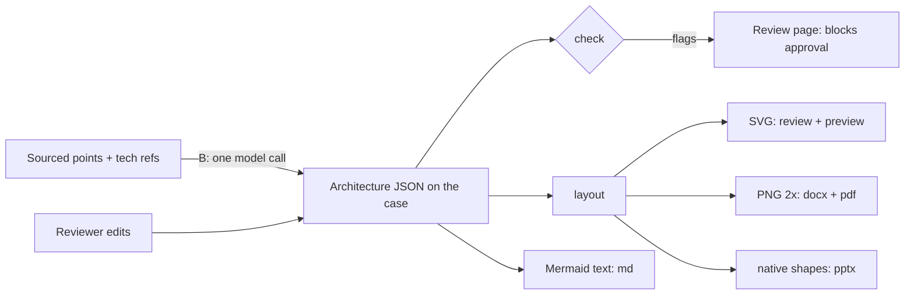

# Spec: Architecture diagrams a bid team can show a customer

The intent's decisions apply:

- **Renderer:** our own lane layout, with native pptx shapes.
- **First draft:** the model proposes it and the reviewer edits it.
- **Document diagrams:** "Use" for document diagrams stays.
- **Placeholders:** they are already removed (chore branch
  `chore/246-no-placeholder-diagrams`).

## Design

There are two phases, each its own PR:

- **Phase A, the model and the drawing.** It needs no AI: the data model,
  the layout, four renderers, the outputs and the demo.
- **Phase B, the proposal and review.** The model drafts the diagram from
  the sourced points, it is checked, and the reviewer edits it.

Phase A alone already replaces the placeholders with real demo diagrams.



### A1. Data model (`app/schema.py`)

**`Architecture`**, stored on `ReferenceCase.architecture: Architecture |
None`. It is hidden from the extraction schema (`SkipJsonSchema`) and is
JSON in `cases.data`, so no migration is needed.

- **`components`:** a list of at most 12. Each has:
  - `id` (a slug)
  - `name` (at most 40 characters)
  - `role` (at most 70 characters)
  - `zone`, one of `channels`, `experience`, `integration`, `core`, `data`,
    `platform`, `external`
  - `kind`, one of `user`, `app`, `service`, `queue`, `store`, `external`,
    `platform`
  - `cite`, the point it rests on, for example `"solution 2"`,
    `"configuration 1"` or `"reference 3"`
- **`flows`:** a list of at most 14. Each has:
  - `src` and `dst` (component ids)
  - `label` (at most 40 characters)
  - `mode`, one of `api`, `event`, `batch`, `file`, `ui`, `data`
  - `cite`
- **`callouts`:** a list of at most 3. Each has `text` (at most 60
  characters) and `outcome` (an index into `case.outcomes`).
- **`title`**, at most 80 characters. It defaults to "Solution
  architecture".
- **`by_reviewer`** (bool) and **`flags`** (list[str]), with the same meaning
  as on `Prose`.

**Validation:**

- Unknown zones, kinds and modes are rejected by pydantic `Literal`.
- A flow whose `src` or `dst` is unknown is dropped.
- A component with neither a `cite` nor a tech-stack or reference match is
  dropped.
- The caps are enforced in a `model_validator`, keeping the first n items.

### A2. Layout (`app/archdiagram.py`, new, pure functions)

- **Canvas:** 1600×900 logical units, 16:9, so it fills a slide.
- **Columns, left to right:** `channels`, `experience`, `integration`,
  `core`, `data`, and `external` on the right edge.
- **Platform band:** `platform` is a full-width band along the bottom, for
  example Kubernetes, the Azure landing zone or CI/CD.
- **Empty zones:** a zone with no components takes no width; columns are
  rebalanced.
- **Zone headers:** each zone has a header label and a light tint.
- **Components:** each is a rounded card, 230×78, with a kind glyph (a small
  shape: cylinder for `store`, stacked bars for `queue`, person for `user`,
  cloud for `external`), the name in bold 15 pt and the role in 12 pt,
  wrapped to 2 lines with an ellipsis.
- **Order within a column:** components are ordered by barycentre of their
  neighbours' positions (two sweeps), which removes most crossings.
- **Flows:** orthogonal elbow connectors, routed through the gutter between
  columns, with arrowheads.
  - The label sits in a pill at the midpoint, with a mode glyph: ⚡ event,
    ↔ api, ⧗ batch, ▤ file.
  - Parallel flows between the same column pair are offset in steps of
    10 units.
- **Callouts:** up to 3 numbered outcome badges in the top-right corner, for
  example "① forecast error 31% → 18%", each tied to its outcome.
- **Legend:** a small row of mode glyphs bottom-left, and a footer with
  "Source: <case title> · reviewed <date>".
- **Output:** `layout(arch) -> Scene`. A Scene is boxes, lines and texts with
  absolute coordinates and style keys, not colours. It is deterministic: the
  same input gives the same Scene.

### A3. Renderers, one per output (`app/archdiagram.py`)

- **SVG:** `to_svg(scene, theme)`, inline, with the brand palette.
  - Used on the review page and in the HTML preview, inside #243's paper
    frame, so it stays readable in dark mode.
  - Text is escaped.
  - It has no external references and no `<script>`, and is served inline.
- **PNG:** `to_png(scene, scale=2)` with Pillow, which is already installed.
  It gives 3200×1800 px, about 270 dpi at 30 cm wide, so it is sharp in Word
  and PDF.
  - Fonts: IBM Plex Sans TTF files (OFL) added under `brand/fonts/`. The
    static web files are woff2, which Pillow can't read.
- **pptx:** `to_pptx_shapes(slide, scene, box)` with python-pptx, which is
  already installed.
  - Rounded-rectangle autoshapes for components and zones.
  - Elbow connectors with arrowheads, and text boxes for labels.
  - Theme font, brand colours.
  - Every shape is editable on the slide.
- **Markdown:** `to_mermaid(arch)`, a `flowchart LR` block with `subgraph`
  per zone and labelled edges. GitHub, Confluence and most viewers render it,
  and it stays plain text otherwise. Labels are escaped for Mermaid
  (quotes, brackets, `|`).

**Why not SVG in docx?** docxtpl's `InlineImage` takes a raster image, and
SVG in Word needs a PNG fallback anyway. The 2x PNG is sharp in print and in
PDF. This narrows the intent's "SVG or EMF" for Word and PDF: the vector
format goes where it matters, editable shapes in PowerPoint and SVG on
screen.

### A4. Outputs (`app/render.py`, brand templates)

- **What renders:** a case's `architecture` renders only when the case is
  approved and the architecture is not removed. Check flags must be
  resolved, as for prose.
- **`case_study_docx` / `case_study_pdf`:**
  - "Architecture" section: the architecture PNG with a caption ("Solution
    architecture, drawn from the reviewed case").
  - Then any used document diagrams, as today.
- **Bid `docx` / `pdf`:** the same image in each case's section.
- **`pptx`:** a new slide per case after the case slide, titled
  "<case title>: solution architecture", with native shapes. The fallback
  layout uses a blank slide with a title box.
- **`md`:** the Mermaid block under "Architecture".
- **Preview:** the SVG, so it matches what each format will show.
- **Anonymisation:** all architecture text goes through `section()` and then
  `protect()`, the same as other case text. `blocked()` drops a name that
  still identifies a protected client. A withheld architecture is omitted,
  and the omission is counted in the note.
- **Templates:** the `make_reference_template.py` loops gain the
  architecture image. Both `.docx` templates are regenerated.

### A5. Demo (`demo/cases.json`, `scripts/seed_demo.py`)

- **The data:** each of the 9 approved demo cases gets a hand-written
  fictional `architecture`: 6–10 components, 6–12 flows and 1–2 callouts.
  - Every component and flow cites a point whose quote is in the demo
    document text.
  - The architecture passes the same `check_architecture` (B2), so a bad demo
    spec fails the seed's validation before any write.
- **The seed:** it stores `case.architecture`, and no PNG is stored. The
  completeness checklist item "diagram" is met by an architecture or a used
  document diagram, so the demo cases are back to 9/9.

### B1. Proposal (`app/writeup.py`)

- **When:** after the prose, one more `EXTRACT_MODEL` call per case with
  `ARCH_SYSTEM`.
- **The input** is the numbered, sourced points only:
  - `solution n` and `implementation n` with their quotes
  - `configuration n`
  - `reference n` (tech references)
  - the tech stack
  - the outcomes, with their index

  The input is small, and the call never sees the document.
- **The output** is the flat JSON that small models handle (the #53
  finding): `{components:[{name, role, zone, kind, cite}], flows:[{from, to,
  label, mode, cite}], callouts:[{text, outcome}]}`. Code assigns the ids and
  builds the `Architecture`.
- **The prompt rules:**
  - Use only names that appear in the cited point's quote or in the
    reference list.
  - The role describes what the component does in this engagement.
  - Flows only between listed components.
  - No price.
  - Prefer 6–10 components.
- **On failure:** a class-only `needs_attention` note ("architecture
  proposal failed"). There is no diagram, and the case is otherwise fine.
- **Re-extraction:** a reviewer's architecture (`by_reviewer`) is kept, as
  for prose (#198).
- **Model call:** this uses `complete_json` and so benefits from #245's
  schema-echo retry. There is no hard dependency on #245.

### B2. Check (`app/schema.py`, `check_architecture`)

- **Component names and roles, flow labels and callout texts** each go
  through `check_prose(text, cited_quotes, all_quotes)`, so any number or
  name must appear in the quotes.
- **A component name** must also match the cited quote, a tech-stack value or
  a tech reference, after normalisation.
- **A callout number** must match its outcome.
- **Commercial terms** are flagged.
- **Flags** are listed in `architecture.flags` and in `needs_attention`
  ("Architecture names 'Snowflake', which no point supports"). They block
  approval until fixed or overridden, as prose flags do.

### B3. Review (`review_detail.html`, `app/review.py`)

- **An "Architecture" panel** shows the SVG, the flags, and the cited points
  and quotes in a collapsed list.
- **Editing** is a text box in a simple line format, parsed back on save and
  then checked:

  ```text
  title: Claims platform architecture
  component: Claims portal | customers submit and track claims | experience | app | solution 1
  component: Kafka | event backbone for claim status | integration | queue | configuration 2
  flow: Claims portal -> Kafka | claim submitted (event) | event | configuration 2
  callout: forecast error 31% -> 18% | 0
  ```

  - Parse errors are listed by line, and the previous version is kept.
- **Buttons:**
  - "Regenerate", which re-runs B1, with a confirmation if the reviewer has
    edited it.
  - "Remove".
- **Audit:** every change reopens an approved case (#143 rule) and is written
  to the audit log.
- **Document candidates:** a "Use" on a document candidate still adds a
  document diagram (#212 C). The case study shows the architecture first and
  the used document diagrams after it.

## Alternatives rejected

- **Graphviz `dot`.** It adds a system package to the image, and its free
  layout is hard to keep on-brand and stable between edits. The user chose
  the lane layout.
- **Mermaid or a headless browser rendering SVG to PNG.** That needs Node or
  Chromium in the worker, which is a heavy attack surface. Mermaid is used
  only as Markdown text.
- **SVG to PNG with cairosvg.** That is a new native dependency. Drawing the
  same Scene with Pillow avoids it.
- **The model writing SVG or Mermaid directly.** It is unverifiable and
  unstable. A structured graph can be checked line by line.
- **The model drafting from the whole document.** It is too large for the
  local model and unsourced. The points-only input keeps every label
  checkable.

## Risks

- **Model quality on a 14B model.**
  - Components may come out thin or get the wrong zone.
  - Mitigations:
    - the editor makes a fix quick
    - the zone defaults per kind
    - the eval below measures components, flows and flags per case, counts
      only
- **Layout clutter.** Twelve components and fourteen flows can still crowd
  the canvas. Mitigations:
  - the caps
  - barycentre ordering
  - labels in pills
  - a test that no two component boxes overlap and that labels stay inside
    the canvas
- **Fonts.** The PNG needs the TTF files in the image. A test renders a
  scene and checks that text was drawn, so a font load that silently falls
  back is caught.
- **pptx fidelity.** Connector routing in PowerPoint differs slightly from
  the PNG. That is acceptable, because shapes stay editable. A test reads
  back shape count and text.
- **Confidentiality.** Nothing from the real presale documents is used in
  fixtures. The eval prints counts only.

## Verification

- **Unit tests:**
  - the schema caps and validation
  - the layout is deterministic, with no box overlaps, everything inside the
    canvas, and empty zones collapsed
  - SVG escaping, with no script
  - the PNG size, and that text pixels are present
  - pptx shape and connector counts and their text
  - Mermaid escaping
  - in phase B:
    - `check_architecture` flags an unsourced name, a number and a price
    - the line format round-trips
    - flags block approval
    - a reviewer's edit survives re-extraction
    - anonymisation and `blocked()` apply in every output
- **Demo:**
  - every approved demo case shows a proper architecture in the preview,
    Word, PDF and PowerPoint, with editable shapes
  - screenshots for the user before the PR
- **Eval (phase B):**
  - `scripts/eval_extraction.py` reports per document: components, flows,
    flags, and how many components have a cite
  - counts only, local `qwen3:14b`
- **Codex:** a read-only review per phase.
- **Full suite:**
  `docker compose build app && docker compose run --rm app pytest`, per
  phase.
